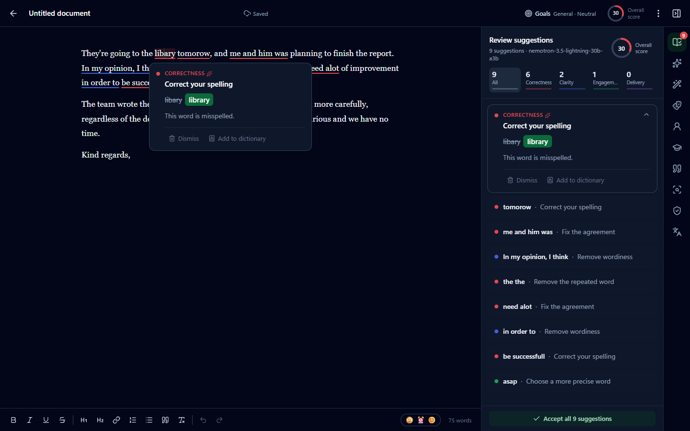

# NimbleWrite

An AI writing assistant that runs on **NVIDIA NIM** models. It checks your writing as you type, explains every suggestion, and includes generative writing tools and review agents.

[](https://github.com/esprit112/NimbleWrite/actions/workflows/ci.yml)  



## Download

**[Download the Windows installer](https://github.com/esprit112/NimbleWrite/releases/latest)** (Windows 10/11, 64-bit). It installs the desktop companion and the editor, with everything they need included, and asks for your own NVIDIA API key on first run (you can create one at [build.nvidia.com](https://build.nvidia.com)). The installer isn't code-signed yet, so Windows SmartScreen may say "Windows protected your PC": choose **More info → Run anyway**. Each release lists the installer's SHA-256 so you can check the download.

## Quick start

```bash
npm install
cp .env.example .env          # then put your key from https://build.nvidia.com in NVIDIA_API_KEY
npm run build && npm start    # → http://localhost:4317
```

For development with hot reload, run `npm run dev`. This starts the API on :4317 and the Vite UI on **http://localhost:5317**, which proxies `/api` to the API.

| Script | What it does |
|---|---|
| `npm run dev` | API (tsx watch) + Vite dev server |
| `npm run build` | Production build of the web app into `dist/`, then a check that no API key leaked into it |
| `npm start` | One server on :4317 that serves the API and the built app |
| `npm test` | Unit tests (vitest): rules, offsets, JSON repair, citations, plagiarism, editor engine, Tune suggestions |
| `npm run typecheck` | `tsc --noEmit` across client, server, shared code and tests |
| `node scripts/smoke-api.mjs [check\|misc\|write\|agents\|tools]` | Live API smoke test against NIM (server must be running) |

## Features

| Feature | What it does |
|---|---|
| Underlined suggestions with cards (accept, dismiss, add to dictionary) | Colour-coded underlines (red correctness, blue clarity, green engagement, purple delivery). Hover or click for a card, plus a sidebar list with category filters and **Accept all** (one undo step). |
| Correctness, Clarity, Engagement, Delivery | Four suggestion categories. The NIM check model handles grammar, spelling, word confusion, agreement, punctuation, tone and word choice. Instant local rules cover common misspellings (`libary`, `definately`, `alot`) and missing apostrophes (`dont`, `isnt`) so they're caught every time, plus repeated words, spacing, capitals, English-variant spelling, and wordy or redundant phrases. |
| Goals (audience, formality, domain, intent) | Shown for new documents; they change the model's instructions. |
| Overall score and Performance | Score, word count, reading and speaking time, word and sentence length, Flesch readability, grade level, unique and rare words (outside the 5,000 most common), and a downloadable report. |
| Tone detector | Top three tones with emoji, formality, sentiment and a one-line summary. |
| Synonyms (double-click) | Context-aware synonym senses from the model; click one to swap it in. |
| AI Assistant (generative writing) | Quick actions (improve, shorten, expand, simplify, professional, friendly, confident, persuasive, fix grammar, summarise, continue, reply, outline, brainstorm) or a free-text instruction. Results stream in with a word-level diff and Replace, Insert or Copy. |
| Paraphraser agent | Standard, fluent, formal, academic, simple, creative, expand, shorten and custom voice. |
| AI Humanizer | Rewrites stock AI phrasing (uses Wikipedia's "Signs of AI writing" patterns). |
| Translate | 30+ languages through Nemotron Ultra (or Riva Translate). |
| Reader Reactions agent | Predicts takeaways, questions and confusing passages for a chosen reader. |
| AI Grader agent | Rubric-aligned feedback and an estimated grade. Paste or upload the brief. |
| Citation Finder and generator | Finds claims that need sources. Cites any URL or DOI in APA 7, MLA 9, Chicago or Harvard, with editable fields, and adds it to a References section. |
| AI Detector | Per-passage AI likelihood from the model plus statistical signals (sentence rhythm, AI vocabulary, stock transitions, and typos as a human signal). |
| Plagiarism Checker | Six-word shingle overlap against your other documents, pasted text, source URLs and, optionally, the web (Brave Search). |
| Documents, upload, download | Document list with search, upload of .docx/.txt/.md/.html (drag and drop works), duplicate, trash and restore. Download as .docx, .txt, .md or .html, print to PDF, or copy rich text. |
| Personal dictionary, style guide, snippets | All three live in Settings. Type `\shortcut` and press Space to expand a snippet. |
| Customise suggestions in plain language | **Tune suggestions** chat in the Review panel: say "stop flagging passive voice" or "allow sentence fragments" and NimbleWrite proposes the settings changes (muted suggestion types, standing preferences, dictionary words, style rules). Nothing changes until you press Apply. **Stop suggesting this** on any card switches that kind off, and Settings → Suggestions lists your preferences and switched-off kinds. Preferences are also given to the AI Assistant and the other writing tools. Muting a kind is exact; free-text preferences are followed by the model on a best-effort basis. |
| Blank-page ideas | A new, empty document offers starters (draft an email, outline an essay, brainstorm, opening paragraph, cover letter, social post) or a free-text request. The draft streams in and you choose Insert, Retry or Discard. |
| Language preferences | British, American, Canadian, Australian and Indian English. AI suggestions that would switch your variant (e.g. *organised → organized* for en-GB) are filtered out. |
| Insights | Words checked and fixes accepted over the last 7 days. |

## How it works

```
Browser (React 19 + TipTap 3)                         Server (Express 5, port 4317)            NVIDIA NIM
┌───────────────────────────────┐   /api/ai/check     ┌──────────────────────────┐   HTTPS   ┌──────────────────────┐
│ Checker: only changed          │ ──────────────────▶ │ Zod-validated routes     │ ────────▶ │ nemotron-3.5-        │
│ paragraphs are sent (hash      │                     │ prompts → NIM (key here) │           │ lightning (checks)   │
│ cache), local rules run        │ ◀────────────────── │ locate.ts: exact offsets │ ◀──────── │ nemotron-3-ultra     │
│ instantly, decorations mapped  │   issues + offsets  │ tolerant JSON repair     │           │ (writing, agents)    │
│ through every edit             │                     │ file-backed JSON store   │           └──────────────────────┘
└───────────────────────────────┘                      └──────────────────────────┘
```

- **Offsets come from the server, not the model.** Models are bad at counting characters. They return the exact `original` text plus a few words of preceding context, and `server/locate.ts` finds the true position. It folds curly and straight quotes and dashes, prefers whole words, and keeps a sentence-initial capital.
- **Incremental checking.** Each paragraph is hashed. Only new or changed paragraphs go to the model, in batches of up to six. Accepting a suggestion updates the cache, so it never costs another model call, and undo restores earlier suggestions instantly.
- **Underlines stay put while you type.** Suggestions are ProseMirror decorations mapped through every transaction. A suggestion disappears as soon as the text it refers to is edited.
- **Thinking is off** (`enable_thinking: false`) for the low-latency check model. Typical full checks take 3–8 s; first streamed tokens of a rewrite arrive in about 1–4 s.

## Desktop companion (Windows)

`desktop/` is a small Windows app that brings NimbleWrite's checks to the text box you're typing in, in any app: Chrome, Edge, Electron apps, Notepad, WPF, WinForms and Win32 fields. It's a thin client. Checking and rewriting go through the same server (`/api/ai/assist`, `/api/ai/write`, `/api/ai/tone`), so it uses your saved settings, dialect and dictionary.

```bash
cd desktop
dotnet build -c Release                     # or: dotnet publish -c Release -r win-x64 --self-contained false -p:PublishSingleFile=true -o publish
bin/Release/net10.0-windows/NimbleWrite.exe # starts the server too if it isn't running
dotnet test tests                           # 104 unit tests: text model, SSE parser, hotkeys, focus after the shortcut, privacy guards, key store, launcher
```

It needs the .NET 10 Desktop Runtime (the [installer](#windows-installer) includes everything instead). If the exe lives inside this folder and the server isn't running, it starts the server itself (`node` + `tsx`, so `npm install` must have been run), and stops that server again when you quit. If the server drops out, the badge and panel say so, and the message clears by itself once the server is back.

- **What you see:** coloured underlines under each issue, an **N** badge in the corner of the field showing the count, and a card when you hover an underline (accept, dismiss, add to dictionary). Click the badge or press **Ctrl+Alt+N** to open the assistant: fix all spelling and grammar, AI rewrites (Improve, Shorten, More formal…) with Replace / Copy, and tone detection. A fix that's been accepted is never offered again, and suggestions the text already contains (a comma or full stop that's already there) are dropped, so accepting can't duplicate punctuation.
- **Ctrl+Alt+N and menu bars:** Windows keeps the N from the app, so the app sees Alt pressed and released on its own, and Windows 11 Notepad moves the keyboard to its menu bar when that happens. NimbleWrite notices, keeps the assistant open and puts the keyboard straight back in your text (if a menu holds on, it presses Escape once to close it). Typing carries on where you left off. Classic Win32, WPF and WinForms menus don't react to the shortcut at all.
- **Your preferences apply here too:** suggestion kinds you switched off and the writing preferences you set in the editor (Settings → Suggestions, or the Tune suggestions chat) also shape what the companion underlines and how its rewrites sound.
- **Tray menu:** turn it on or off, pause for an hour, switch it off for the current app, start with Windows.
- **How it works:** one background thread uses Windows UI Automation to find the focused field, read its text and measure each issue's position. A click-through, topmost overlay draws the underlines; the badge, card and panel never take focus away from your app. Fixes are applied by selecting the exact range and typing, with a short pause per character. If an app garbles the typing (Windows 11 Notepad repeats the last letter when it falls behind), the companion selects exactly what landed and pastes the intended text instead. Every edit is verified against the expected result. Older WPF apps report text positions without display scaling; the companion detects them and scales the positions so underlines still sit under the words.
- **Running alongside other writing assistants:** if another writing app or browser extension is underlining the same text, switch one of them off for that app (NimbleWrite's tray menu has **Turn off in <app>**).

**Privacy.** The companion sees every text box on the PC, so it's deliberately cautious:

- Password fields are never read.
- Terminals, code editors, password managers, Remote Desktop and the Windows shell are off by default, and so are browser address bars.
- Text that looks like credentials (API keys, private keys, `NAME_KEY=value` lines, `Password:` lines) is never checked or sent to the AI; the panel says why.
- Lines that look like code or config aren't sent for checking.
- The log at `%LOCALAPPDATA%\NimbleWrite\desktop.log` records structure only (which app it attached to, whether a fix applied), never your text.
- Clipboard pastes are kept out of Windows clipboard history, and your clipboard is restored afterwards.

Settings live in `%APPDATA%\NimbleWrite\desktop.json`. Run with `--diag` to write a live state snapshot (positions and counts, no text) to `%LOCALAPPDATA%\NimbleWrite\diag.json`.

## Windows installer

To install NimbleWrite on other PCs, build a normal Windows setup program:

```bash
npm run package:win    # about a minute -> build/installer/NimbleWrite-Setup-<version>.exe (+ .sha256)
```

Building needs Windows, Node 24+, the .NET 10 SDK and [Inno Setup 6](https://jrsoftware.org/isinfo.php) (`winget install JRSoftware.InnoSetup`). `scripts/package-win.mjs` does the following:

1. Builds the web editor, including the bundle key check.
2. Bundles the server into one file with esbuild, so no `node_modules` ship.
3. Copies in the Node.js runtime.
4. Publishes the desktop app self-contained.
5. Writes third-party notices.
6. Scans every staged file: it stops the build if it finds your key, anything shaped like an `nvapi-` key, an `.env` file or a `data/` folder.
7. Compiles `installer/NimbleWrite.iss`.

The version comes from `package.json`.

**What people get.** A 71 MB setup program with nothing else to install first, because .NET and Node are inside. On a first install it asks how to install:

- **Install for me only** (the default): no admin prompt, into `%LOCALAPPDATA%\Programs\NimbleWrite`.
- **Install for all users**: Windows asks for permission, then it installs into `C:\Program Files\NimbleWrite`, with Start menu entries for everyone.

Without admin rights, folders such as Program Files are read-only, so the folder page checks the chosen folder before going on: if Setup can't write there, it explains and offers the person's own folder instead (a silent install pointed at such a folder with `/DIR=` stops without changing anything). Each person who uses NimbleWrite still adds their own key and keeps their own settings. The installer:

- adds **NimbleWrite** and **NimbleWrite Editor** to the Start menu;
- can start NimbleWrite when you sign in (the app records this for the person who ran Setup, even in an all-users install);
- runs it straight away.

**Each person uses their own NVIDIA API key.** Your `.env` is never packaged.

- **Setup:** on first run, NimbleWrite asks for a key from [build.nvidia.com](https://build.nvidia.com/). It tries the key with NVIDIA, then saves it encrypted with Windows DPAPI, readable only by that Windows account on that PC, in `%APPDATA%\NimbleWrite\nvidia.key`.
- **Where it goes:** the app passes the key to its local server through the environment. It never appears in logs or on a command line.
- **Changing it:** **NVIDIA API key…** in the tray menu changes or removes it.
- **Without a key:** the built-in spelling and grammar rules still work.

The installed app runs its own server on port 4317. It keeps documents and settings in `%APPDATA%\NimbleWrite\data` and logs in `%LOCALAPPDATA%\NimbleWrite` (`desktop.log`, and `server.log` for the server). The server stops when the app quits, or if the app crashes.

**Upgrades and uninstalling.**

- **Upgrading:** run a newer setup program. It closes the running copy first, and keeps the install mode and folder of the copy already there (no questions asked).
- **Moving between "just me" and "all users":** uninstall first (choose No to keep documents, settings and the key), then run Setup again and pick the other option.
- **Uninstalling:** use Windows Settings → Apps. It asks whether to delete documents, settings and the saved key; the default keeps them.
- **Unattended installs:** `NimbleWrite-Setup-1.0.6.exe /VERYSILENT /TASKS="startup"` installs silently (add `/ALLUSERS` for Program Files, from an elevated prompt, or `/CURRENTUSER`), and `unins000.exe /VERYSILENT` removes it, keeping user data.

**Not code-signed yet.** On other PCs, Windows SmartScreen will say "Windows protected your PC" for a downloaded installer: choose **More info → Run anyway**. Signing it needs a code-signing certificate and an Inno Setup `SignTool` line in the `.iss`.

On a development PC, the installed app and this repo share `%APPDATA%\NimbleWrite\desktop.json` and port 4317. Whichever server starts first serves both, so don't run the installed app and `npm run dev` at the same time.

## Security

- In development the NVIDIA key lives only in `.env` on the server; in the installed app each person's own key is DPAPI-encrypted for their Windows account (see [Windows installer](#windows-installer)). It never reaches the browser bundle: `npm run build` runs `scripts/check-bundle.mjs`, which fails the build if the key, or anything shaped like an `nvapi-` key, appears in `dist/`.
- The API only accepts requests from `localhost` and `127.0.0.1` origins, so another website can't use your key through your browser. Requests must also be addressed to `localhost`/`127.0.0.1` (the `Host` header), which stops DNS-rebinding tricks where a website points its own domain at your PC.
- Imported documents are sanitised (scripts, iframes and event handlers removed), and AI or citation HTML is rendered through DOMPurify.
- Data is stored locally in `data/` as JSON files with atomic writes. `data/` and `.env` are git-ignored.

## Configuration

See `.env.example`. You can change models at any time in **Settings → AI models**, which lists every chat model your key can access and has a **Test** button.

Optional `BRAVE_API_KEY` enables web search for the plagiarism checker and Citation Finder. Without it, plagiarism checks cover your documents and the sources you supply, and Citation Finder links to Google Scholar.

## Project layout

```
server/   Express API: routes/ai.ts (check, tone, synonyms, tune, write SSE, agents), routes/data.ts (docs, settings,
          import, plagiarism, citations), nim.ts (client, retries, concurrency), locate.ts, json.ts, prompts.ts
shared/   Types, text statistics, readability and score, local rules (dialects, mechanics, clarity, style guide)
src/      React app: editor/ (TipTap, suggestion plugin, checker, panels), pages/ (home, settings)
desktop/  Windows companion (C# WPF, .NET 10): Core/ (UI Automation engine, text model, API client, key store,
          server launcher), UI/ (overlay, badge, card, panel, tray, NVIDIA key window), tests/ (xunit)
installer/ Inno Setup script (NimbleWrite.iss), wizard artwork and the script that draws it, Node.js licence
scripts/  check-bundle.mjs (key leak guard for the web bundle), package-win.mjs (builds the Windows installer)
tests/    vitest unit tests
```

## License

[MIT](LICENSE). The Windows installer also ships the .NET runtime and Node.js, with their licences and a list of every bundled package in `THIRD-PARTY-NOTICES.txt`, generated when the installer is built.
